<p align="center">
  
</p>

<p align="center">
  <a href="https://github.com/netspeedy/s3mirror/releases"></a>
  <a href="LICENSE"></a>
  <a href="https://github.com/netspeedy/homebrew-s3mirror"></a>
  <a href="https://github.com/netspeedy/s3mirror"></a>
  <a href="https://buymeacoffee.com/soakes"></a>
</p>

---

This is the Homebrew tap for [s3mirror](https://github.com/netspeedy/s3mirror). s3mirror copies buckets and objects from one S3-compatible endpoint to another, copying only what's new or changed, and can remove what exists only at the destination.

## Install

```bash
brew tap netspeedy/s3mirror
brew install s3mirror
```

The formula installs s3mirror on macOS and Linux with Homebrew's Python 3.14 and its own virtual environment. `brew install --HEAD s3mirror` builds the latest `main` instead of the last release.

> On recent Homebrew, new third-party taps require explicit trust. If installation is refused, run `brew trust netspeedy/s3mirror` once, then `brew install s3mirror`.

## Try it

Put both endpoints in a config file:

```yaml
source:
  endpoint_url: "https://s3.source.example.com"
  aws_access_key_id: "SOURCE_ACCESS_KEY"
  aws_secret_access_key: "SOURCE_SECRET_KEY"

destination:
  endpoint_url: "https://s3.destination.example.com"
  aws_access_key_id: "DEST_ACCESS_KEY"
  aws_secret_access_key: "DEST_SECRET_KEY"
```

Then make the first run copy-only, with every decision shown:

```bash
s3mirror --config config.yaml --no-delete --debug
```

Deleting destination-only objects is on by default, so keep `--no-delete` until the bucket list and object counts look right. `--show-config` prints the configuration s3mirror will use, with the secret keys redacted. The [main README](https://github.com/netspeedy/s3mirror#readme) covers every config key, scheduled runs, the container image and the safety notes.

## Upgrade or remove

```bash
brew upgrade s3mirror
brew uninstall s3mirror
brew untap netspeedy/s3mirror
```

## Available formulae

| Formula | Description |
|---|---|
| [`s3mirror`](Formula/s3mirror.rb) | Mirror buckets and objects between S3-compatible endpoints |

## About this tap

This repository only packages [`Formula/s3mirror.rb`](Formula/s3mirror.rb). The s3mirror release workflow updates it for each stable [release](https://github.com/netspeedy/s3mirror/releases). The formula installs `boto3`, `botocore`, `s3transfer`, `urllib3`, `PyYAML` and their dependencies into the virtual environment at install time. The names are listed explicitly because Homebrew installs Python packages with `--no-deps`, and the versions aren't pinned. Please open issues in the [main repository](https://github.com/netspeedy/s3mirror/issues).

The banner at the top of this page and the repository's social preview image are generated. Edit the copy, layout or timing in `.github/scripts/build_readme_hero.py` and run it to rebuild `assets/s3mirror-readme-hero.svg` and `assets/s3mirror-social-preview.png`; the preview is uploaded by hand under Settings, since GitHub has no API for it. The script downloads the font subsets from Google Fonts, so it needs network access, and renders the preview with headless Chrome or Chromium.

## License

Copyright © 2026 [Simon Oakes](https://github.com/soakes). Released under the [MIT License](LICENSE).

This tap only packages the [s3mirror](https://github.com/netspeedy/s3mirror) formula, an unofficial community tool that is not affiliated with, endorsed by, or sponsored by AWS, Amazon S3, or any S3-compatible storage provider.
